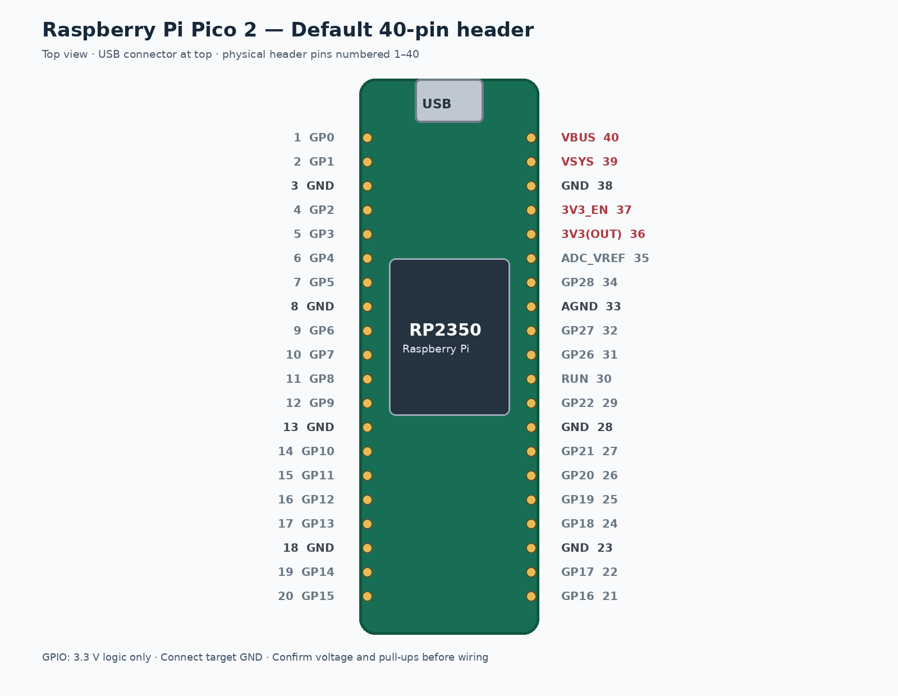
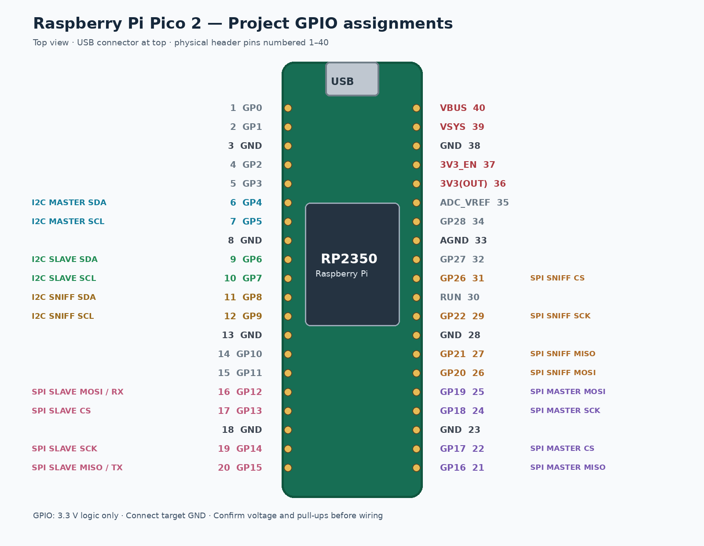

# Pico2_I2C_Controller

**Raspberry Pi Pico 2–based I²C and SPI controller and logic-analyzer interface for Serial Flux (SF), the I2C Logic Analyzer GUI, and the SPI Logic Analyzer GUI (SLA).**

## Overview

Pico2_I2C_Controller uses the **Raspberry Pi Pico 2** as a USB-connected hardware interface for working with I²C and SPI devices. The project is intended to support three PC-side workflows:

- **Serial Flux (SF):** A general-purpose communication and debugging application for interacting with connected hardware, sending commands, and inspecting responses.
- **SPI Logic Analyzer GUI (SLA):** A dedicated interface for viewing SPI capture data forwarded from the Pico 2 through Serial Flux. SPI capture streaming is experimental; desktop-side protocol support must be verified.
- **I2C Logic Analyzer GUI:** A dedicated interface for examining I²C bus activity and making transactions easier to understand during development and troubleshooting.

The Pico 2 provides the physical connection to the target I²C or SPI bus, while the PC applications provide the user interface. Exact firmware commands, capture capabilities, and supported operating modes depend on the firmware implementation.

## Raspberry Pi Pico 2 hardware

The Raspberry Pi Pico 2 is a compact microcontroller development board built around the **Raspberry Pi RP2350**.

| Feature | Pico 2 specification |
| --- | --- |
| Microcontroller | Raspberry Pi RP2350 |
| CPU | Two Arm Cortex-M33 cores **or** two Hazard3 RISC-V cores (selectable architecture) |
| Maximum nominal CPU clock | 150 MHz |
| On-chip SRAM | 520 KB |
| On-board flash | 4 MB |
| USB | USB 1.1 controller with device support; Micro-USB connector |
| Logic voltage | 3.3 V GPIO |
| GPIO | 26 user-accessible multifunction GPIO pins |
| Hardware I²C | Two I²C controllers |
| Hardware SPI | Two SPI controllers |
| Programmable I/O | 12 PIO state machines across three PIO blocks |
| Form factor | 40-pin, breadboard-friendly board |

The RP2350's hardware I²C and SPI controllers and programmable I/O (PIO) make the Pico 2 useful for embedded communication tools. The specific pins and peripherals used by this project will be documented in the pinout section.

> **Electrical caution:** Pico 2 GPIO operates at 3.3 V and is **not 5 V tolerant**. Check the target bus voltage and use appropriate level shifting when necessary. I²C SDA and SCL require suitable pull-up resistors; avoid conflicting or excessive pull-ups on an existing bus.

## System architecture

```text
                  Windows PC
        +-----------------------------+
        | Serial Flux (SF)            |
        | I2C Logic Analyzer GUI      |
        | SPI Logic Analyzer GUI (SLA) |
        +--------------+--------------+
                       |
                 USB connection
                       |
        +--------------v--------------+
        | Raspberry Pi Pico 2         |
        | RP2350 / project firmware   |
        +--------------+--------------+
                       |
              I2C or SPI interface
              SDA/SCL or MOSI/MISO/SCLK/CS
                       |
        +--------------v--------------+
        | Target board / I2C/SPI bus  |
        +-----------------------------+
```

## Using the controller with Serial Flux

**Serial Flux** is the PC-side environment for communicating with and debugging embedded devices. With the appropriate Pico2_I2C_Controller firmware and SF configuration, the Pico 2 can serve as the hardware bridge between SF and an I²C target.

Typical development tasks include sending supported commands, viewing device responses, and recording communication for troubleshooting. The exact command syntax, USB interface, and supported I²C operations will be documented alongside the firmware.

## Using the controller with the I2C Logic Analyzer GUI

The **I2C Logic Analyzer GUI** is intended for inspecting I²C activity through the Pico 2 interface. This workflow is useful when investigating device addressing, register transactions, acknowledgments, and communication problems.

The GUI and firmware determine which capture and decoding features are available. In particular, passive bus monitoring, supported sample rates, timestamps, and trigger behavior should be verified against the implemented firmware rather than assumed from the Pico 2 hardware alone.

## Using the controller with SPI and Serial Flux

The Pico 2 firmware also provides an **SPI interface** for sending supported SPI commands and examining responses through **Serial Flux (SF)**. The firmware documents SPI mode and clock-speed configuration, SPI transfers, and chip-select pulse transfers. Use the firmware `HELP` command for the available syntax.

## Using the controller with the SPI Logic Analyzer GUI (SLA)

For SPI capture, the Pico 2 uses PIO sampling and sends capture records over **USB CDC**. Serial Flux can forward the `SLA_BEGIN`, `SLA_RAW`, and `SLA_END` records to the separate **SPI Logic Analyzer GUI (SLA)**. The Pico does not connect directly to the GUI over TCP.

SPI capture is explicitly started using `SPI NEW CAPTURE` and stopped with `SPI STOP`; `SPI STATUS` reports capture state and diagnostics. The stream is experimental, and the desktop GUI must support the protocol before automatic display will work. The single pending-frame buffer can lose frames during USB transmission, so this should not be presented as guaranteed lossless capture.

See [SPI streaming protocol](docs/README_SLA_STREAM.md) and [Pico 2 W firmware notes](docs/README_PICO2W.md) for details.

## Applications

- Embedded board bring-up and I²C/SPI device evaluation
- Firmware development and debugging
- Troubleshooting I²C and SPI communication and wiring
- Examining register transactions and device responses
- Education and experimentation with I²C peripherals

## Pico 2 pinout and hardware connections

The diagrams below show the **standard Raspberry Pi Pico 2 40-pin header** and the **GPIO assignments used by this repository's firmware**. Both diagrams are top views with the USB connector at the top. `GPxx` denotes GPIO number, not physical header pin number.

### Default Raspberry Pi Pico 2 pinout



### Pico2_I2C_Controller firmware pinout



#### I²C connections

| Function | Peripheral | Signal | GPIO | Physical pin |
| --- | --- | --- | --- | --- |
| Master | I2C0 | SDA | GP4 | 6 |
| Master | I2C0 | SCL | GP5 | 7 |
| Slave | I2C1 | SDA | GP6 | 9 |
| Slave | I2C1 | SCL | GP7 | 10 |
| Sniffer | PIO input | SDA | GP8 | 11 |
| Sniffer | PIO input | SCL | GP9 | 12 |

#### SPI connections

| Function | Peripheral | MOSI (GPIO / pin) | MISO (GPIO / pin) | SCK (GPIO / pin) | CS (GPIO / pin) |
| --- | --- | --- | --- | --- | --- |
| Master | SPI0 | GP19 / 25 | GP16 / 21 | GP18 / 24 | GP17 / 22 |
| Slave | SPI1 | GP12 / 16 | GP15 / 20 | GP14 / 19 | GP13 / 17 |
| Sniffer | PIO + GPIO interrupt | GP20 / 26 | GP21 / 27 | GP22 / 29 | GP26 / 31 |

For SPI slave, **MOSI is the slave RX** (GP12) and **MISO is the slave TX** (GP15). The sniffer is a separate passive input group, not a shared set of master/slave pins. The SPI sniffer uses GP26 to detect chip-select edges.

**Wiring precautions:** All GPIO signals are 3.3 V logic, **not 5 V tolerant**. Connect a common GND to the target (for example physical pin 3, 8, 13, 18, 23, 28, or 38). I²C buses require suitable SDA/SCL pull-ups to the appropriate 3.3 V rail; verify existing pull-ups before adding more. Avoid connecting two actively driving outputs together. These mappings describe the firmware in this repository and should be checked again if GPIO definitions change.

## KTYLabs software

To use the **Pico2_I2C_Controller** with a Windows PC, visit **[KTYLabs](https://ktylabs.com/)** for information about **Serial Flux (SF)**, the **I2C Logic Analyzer GUI**, and the **SPI Logic Analyzer GUI (SLA)**, including available software downloads and setup resources. The Pico 2 requires compatible controller firmware and PC-side software for the intended workflow.

## Software and firmware

This repository is for the Pico2_I2C_Controller project. Depending on the release, it may contain Pico 2 firmware, build files, documentation, and related utilities.

For PC-side operation, use the compatible versions of:

- **[Serial Flux (SF)](https://ktylabs.com/)**
- **I2C Logic Analyzer GUI** (see [KTYLabs](https://ktylabs.com/))
- **SPI Logic Analyzer GUI (SLA)** (see [KTYLabs](https://ktylabs.com/))

Installation, firmware flashing, USB connection settings, and application-specific setup instructions will be added once the corresponding project details are confirmed.

## Project status

Documentation in progress. The next update will define and illustrate the **Raspberry Pi Pico 2 pinout** used by Pico2_I2C_Controller.

## License

See the repository's `LICENSE` file, if provided, for the applicable licensing terms.
